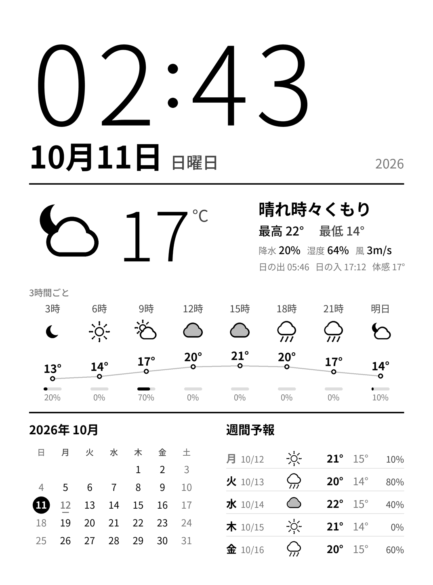

# Kindle サイネージ ＆ スクリーンセーバー

Kindle（第7世代・脱獄＋KUAL導入済み）を、**時計・カレンダー・天気のダッシュボード**として使えるようにします。
**普段は普通に読書端末として使える**状態を保ったまま、次の2つの使い方ができます。

| 使い方 | 内容 | 読書 |
|---|---|---|
| **サイネージ** | 時計が毎分進むダッシュボード（または写真のスライドショー）を常時表示 | 電源ボタン1回で終了 → すぐ読書に戻れる |
| **スクリーンセーバー** | スリープ画面を自分の写真やダッシュボードに差し替え（ON/OFF可） | 読書中は一切影響なし |



---

## 1. システム設計

### 全体構成

```
┌──────────── PC / Raspberry Pi（同じWi-Fi内）────────────┐
│  serve.py                                                │
│   ├─ 10分ごとに render.py で描画                          │
│   │    天気 … Open-Meteo（無料・APIキー不要）              │
│   │    祝日 … jpholiday                                   │
│   └─ HTTPで配信  http://192.168.x.x:8080/                 │
│        dashboard.png   背景（日付・天気・カレンダー）       │
│        clock/0〜9.png  時計の数字スプライト                │
│        layout.txt      時計を描く座標                      │
│                                                           │
│  convert_images.py   写真 → Kindle用PNG（スクセ・スライド用）│
└───────────────────────────────┬──────────────────────────┘
                                │ Wi-Fi（HTTP）
┌──────────── Kindle ───────────┴──────────────────────────┐
│  KUAL ▸ Signage                                           │
│   ├─ Signage: Start/Stop  … signage.sh（常駐ループ）       │
│   │    10分ごと: 背景を取得 → 全面リフレッシュで描画         │
│   │    毎分    : 変わった桁の数字だけ部分描画（ちらつかない）│
│   │    電源ボタン: サイネージ終了 → 通常のKindleへ           │
│   └─ Screensaver: ON/OFF  … ssaver.sh（イベント待ち受け）   │
│        スリープ画面が出た直後に自分の画像で上書き            │
└───────────────────────────────────────────────────────────┘
```

### 設計のポイント

- **重い処理はPC側、Kindleは表示だけ。** 第7世代のKindleには画像を描く道具がほとんど無く、日本語フォントでの描画も難しいので、デザインはすべてPC（Python + Pillow）で作ります。Kindleは標準搭載の `eips` で画像を貼るだけです。
- **時計はKindle側で進める。** 毎分PCから画像を取ると、Wi-Fiも画面のフル書き換えも毎分発生します。そこで数字0〜9を1文字ずつ画像（スプライト）にして先に渡しておき、Kindleが変わった桁だけを差し替えます。通信は10分に1回で済み、画面も黒く点滅しません。
- **E-inkに最適化。** 色は16階調にぴったり乗る値だけを使い、2倍の解像度で描いてから縮小して線をなめらかにしています。スプライトは部分更新が確実に効くよう、位置と幅を8ピクセル単位に揃えています。
- **サーバーが止まっても表示は続く。** 取得に失敗したら前回の画像のまま時計だけ進め、1分後に再試行します。何度も失敗したら左上に `offline` と表示します。天気APIが落ちたときも、PC側は前回の天気データで描画を続けます。
- **Kindle本体のシステムは一切書き換えない。** すべて `/mnt/us`（USBで見える領域）の中だけで完結します。不要になったらフォルダを消すだけで元通りです。

### 読書端末としての安全性

- サイネージ中は自動スリープだけを止めています。**電源ボタンを押すとサイネージが終了し、自動スリープの設定を元に戻してから**通常のスリープに入ります。
- スクリーンセーバーは、Kindle標準のスリープ画面が出た**後で**画像を上書きするだけです。スリープや復帰の仕組み自体には手を入れません。
- 再起動すると常駐プログラムは止まります（＝標準の動作に戻る）。スクリーンセーバーを使い続けたい場合は、再起動後にもう一度 ON にしてください。

---

## 2. ファイル構成

```
kindle/                       ← この中身を Kindle のルートにコピー
  extensions/signage/
    config.sh                 ★設定（サーバーURL・モード・時差など）
    config.xml, menu.json     KUALのメニュー定義
    bin/common.sh             共通関数（取得・時計描画・画像選択）
    bin/start.sh, stop.sh     サイネージ開始・終了
    bin/signage.sh            サイネージ本体ループ
    bin/ss_on.sh, ss_off.sh   スクリーンセーバー ON/OFF
    bin/ssaver.sh             スクリーンセーバー常駐
    bin/ss_test.sh            スクリーンセーバーのプレビュー
    bin/status.sh             状態表示
    bin/touchgrab             タッチパネルを独占する小さなプログラム（ソースは tools/touchgrab.c）
  signage/
    slides/                   サイネージ（slides モード）用の画像
    screensaver/              スクリーンセーバー用の画像
    signage.log               動作ログ（自動作成。不調時はこれを確認）

tools/touchgrab.c             touchgrab のソース（zig cc -target arm-linux-musleabi で再ビルド可）

server/                       ← PC側
  config.json                 ★地点・機種・更新間隔
  render.py                   ダッシュボード描画
  serve.py                    描画＋配信サーバー
  convert_images.py           画像変換
  kindlectl.py                SSH で Kindle に送る・更新・操作
  upload.py                   スマホ用アップロード画面（serve.py の /upload）
  requirements.txt
  fonts/                      （任意）Noto Sans JP を置く場所
```

---

## 3. セットアップ

### 3-1. PC側（サーバー）

1. **Python 3.9以上** をインストールします（Windowsは python.org から。インストール時に「Add to PATH」にチェック）。
2. `server` フォルダでターミナル（コマンドプロンプト）を開き、次を実行します。
   ```
   pip install -r requirements.txt
   ```
3. `config.json` を編集します。
   | 項目 | 説明 |
   |---|---|
   | `location_name` | 画面左上に出る地名 |
   | `latitude` / `longitude` | 天気を取る地点の緯度・経度（Googleマップで右クリックすると表示されます） |
   | `device` | `pw3`（Paperwhite 3）/ `voyage` / `kt2`（無印 第7世代） |
   | `refresh_minutes` | 再描画の間隔（分） |
4. まずデザインを確認します。
   ```
   python render.py --demo
   ```
   `out/dashboard.png` が作られます（ダミーの天気で描画）。
5. サーバーを起動します。
   ```
   python serve.py
   ```
   `配信中: http://192.168.x.x:8080` と表示されたら、そのURLを控えておきます。
   - Windowsで「ファイアウォールの許可」が出たら、**プライベートネットワーク**を許可してください。
   - ブラウザで `http://192.168.x.x:8080/dashboard.png` が開ければOKです。
   - 常時表示するならPCは起動したままにする必要があります。消費電力の小さい **Raspberry Pi** で動かすのがおすすめです（同じ手順で動きます）。

### 3-2. Kindle側

1. PCとUSB接続し、`kindle` フォルダの**中身**（`extensions` と `signage`）をKindleのルートにコピーします。
2. `extensions/signage/config.sh` を開き、`SERVER_URL` を先ほどのURLに書き換えます。
   - **保存時は改行コードを LF に**してください（メモ帳なら右下の「CRLF」を「LF」に。VS Code推奨）。
3. 取り外してKUALを開くと、**Signage** メニューが表示されます。

### 3-3. Wi-Fiについて（重要）

ダッシュボードの表示にはWi-Fiが必要なので、**機内モードはOFF**にします。
勝手にOTAアップデートが入って脱獄が解除されるのを防ぐため、Kindleのルートに **`update.bin.tmp.partial` という名前の空フォルダ**を作っておくのが定番の対策です（多くのファームウェアで有効と報告されていますが、確実ではありません）。もしアップデートが入ってしまった場合は、ライブラリの「Run Hotfix」を実行し直してください。

画像だけを使うモード（`slides` / スクリーンセーバーの `images`）は Wi-Fi 不要なので、機内モードのままで使えます。

---

## 4. 使い方

| KUALメニュー | 動作 |
|---|---|
| **Signage: Start** | サイネージ開始（数秒後に表示） |
| **Signage: Stop** | サイネージ終了 → ホーム画面へ |
| **Screensaver: ON / OFF** | スリープ画面の差し替えを切り替え |
| **Screensaver: Preview** | スリープ画面に出る画像を10秒だけ表示 |
| **Status** | 動作状況・サーバー接続・Kindleの時刻を画面下に表示 |

- **サイネージの終わり方は2つ**:
  - **画面を素早く3回タップ**（2秒以内）→ サイネージ終了 → ホーム画面へ。読書に戻りたいときはこれ
  - **電源ボタン** → サイネージ終了 → そのままスリープ
- サイネージ中は**タッチパネルをサイネージが独占**するので、裏の画面（ホームや本）にはタップが一切届きません（`GRAB_TOUCH=1`）。
- 独占できたときだけ、Kindle本来の画面を一時停止して上に重なるのを防ぎます（`FREEZE_UI=1`）。独占に失敗した場合は安全のため一時停止しません（ログに `safe mode` と出ます）。
- サイネージ中はKUALを開けないので、Status などはサイネージ終了後に使ってください。
- 万一画面が固まったまま戻らないときは、電源ボタンを40秒ほど長押しして再起動すれば元に戻ります（再起動で必ず解除されます）。
- 常時表示は**充電ケーブルを挿したまま**がおすすめです。

### モードの切り替え（config.sh）

```sh
SIGNAGE_SOURCE=dashboard   # dashboard=時計・天気 / slides=写真のスライドショー
SS_SOURCE=images           # images=写真 / dashboard=ダッシュボード
SS_ORDER=sequential        # sequential=順番 / random=ランダム
SS_REFRESH_MIN=0           # SS_SOURCE=dashboard のとき、スリープ中に何分ごと更新するか
```

`SS_SOURCE=dashboard` かつ `SS_REFRESH_MIN=30` のように設定すると、スリープ中も30分ごとに自動で起きて天気を更新します。ただし、スリープ中の時計はその時点の時刻で止まります。また、起きるたびにWi-Fiを使うので電池を消費します。この自動更新は機種やファームウェアによって動かない場合がある**試験的な機能**です。

---

## 5. 画像の変換（convert_images.py）

スマホの写真などを、Kindleで綺麗に見える形に変換します。具体的には、解像度ぴったりにリサイズ・切り抜きし、グレースケールに変換し、E-ink向けに明るさとシャープさを補正し、16階調ディザで仕上げます。

```
# 変換して kindle_images フォルダに出力
python convert_images.py 写真フォルダ

# Kindle（Eドライブ）のスクリーンセーバー用フォルダに直接書き込む
python convert_images.py 写真フォルダ --kindle E:/ --to screensaver

# スライドショー用に。全体を収めて黒い余白、横長写真は回転
python convert_images.py 写真フォルダ --kindle E:/ --to slides --fit contain --bg black --rotate auto
```

| オプション | 説明 |
|---|---|
| `--fit cover` / `contain` | 画面いっぱいに切り抜く（既定） / 全体を収めて余白 |
| `--rotate auto` | 横長の画像を90°回して大きく表示 |
| `--no-dither` | イラスト・文字・ロゴ向け（点描を使わずくっきり） |
| `--contrast` `--brightness` `--sharpen` | 見た目の微調整（既定 1.15 / 1.05 / 1.0） |
| `--device` | 解像度（既定は config.json の device） |

対応形式は JPG / PNG / WebP / BMP / GIF / TIFF です（HEICは `pip install pillow-heif` を追加すると対応）。

---

## 6. 困ったとき

| 症状 | 確認すること |
|---|---|
| KUALに Signage が出ない | `extensions/signage/config.xml` があるか |
| 「Cannot reach …」と出る | PCで serve.py が動いているか / `SERVER_URL` / ファイアウォール / Kindleの機内モード |
| 時計が9時間ずれる | `config.sh` の `TZ_OFFSET_MIN` を `0` に |
| 何も起きない | `.sh` の改行コードが LF か / `signage/signage.log` を確認 |
| スクリーンセーバーが変わらない | Status で ON か確認（再起動後は OFF に戻ります）/ 画像が `signage/screensaver` にあるか |
| スリープ画面が一瞬標準のものになる | `SS_METHOD=auto` にする（`python kindlectl.py set SS_METHOD auto`）。Kindle 自身に自分の画像を表示させるので標準画面は出ない。ログに `native` と出ていれば有効 |
| 自分の画像がすぐ標準の画面に戻される | `SS_REDRAW` を大きく（例: 6） |
| auto でも標準画面が出る（広告付き端末など） | 自動で draw 方式の保険が働き、標準画面が描き終わった後に1回だけ切り替わる |
| サイネージ中にタップが裏に届く | `signage/signage.log` に `touchgrab: grabbed` があるか。`safe mode` と出ていたらログを確認 |
| 本や表紙がサイネージの上に重なる | `config.sh` の `FREEZE_UI=1` になっているか |
| 残像が気になる | `DASH_REFRESH_MIN` を短くすると全面リフレッシュが増えます |

**完全に元に戻す:** Screensaver: OFF → Signage: Stop を実行してから、`extensions/signage` と `signage` フォルダを削除します。

---

## 7. SSH で画像を送る・プログラムを更新する

Kindle に SSH で入れるようにすると、USB ケーブルなしで次のことができます。
- **スマホのブラウザ**から写真を送る（PC が変換して Kindle に転送）
- **PC のコマンド**で写真の送信、プログラムの更新、操作、ログの確認

```
スマホ（ブラウザ）──┐
                    ├─→ PC（serve.py：変換）──SSH──→ Kindle
PC（kindlectl.py）──┘
```

### 7-1. Kindle に SSH を入れる（USBNetwork）

1. MobileRead の NiLuJe 氏のスナップショットのスレッドから **USBNetwork**（`kindle-usbnet-*.tar.xz`）をダウンロードします。
2. 展開した中の **K5 / PW 世代用のインストーラー** `Update_usbnet_*_install*.bin` を、Kindle の `mrpackages` フォルダに入れます。
3. 取り外して、検索バーで `;log mrpi` を実行します。KUAL に **USBNetwork** のメニューが追加されます。

### 7-2. 鍵を作って登録する（パスワード不要で安全に接続するため）

**かんたんな方法:** Kindle を USB でつないだまま、次を実行します（`E:` は Kindle のドライブ）。
```powershell
cd server
powershell -ExecutionPolicy Bypass -File .\setup_ssh.ps1 -Drive E:
```
鍵の作成から `authorized_keys` への書き込み（LF・BOMなし）まで、まとめて行います。

**手動で行う場合:**

PC（PowerShell）で次を実行します。
```powershell
ssh-keygen -t ed25519 -f $HOME\.ssh\kindle -N '""'
Get-Content $HOME\.ssh\kindle.pub
```
表示された1行（`ssh-ed25519 AAAA...`）を、Kindle の **`usbnet/etc/authorized_keys`** というファイル（拡張子なし）に貼り付けて、**LF** で保存します。

### 7-3. Wi-Fi 経由の SSH を有効にする

- Kindle の `usbnet/etc/config` を開き、Wi-Fi 経由の SSH を有効にする設定（`USE_WIFI` など）を `true` にします。
- KUAL の **USBNetwork** メニューで USBNetwork（SSH）を ON にします。

メニューの名前は版によって少し違います。項目の説明は、同梱の README で確認してください。

### 7-4. PC から接続を確認する

1. Kindle の IP アドレスを調べます。ルーターの管理画面で確認するのが確実です。
   - ルーターの設定で、Kindle に**毎回同じ IP** が割り当たるようにしておくと便利です。
2. `server/config.json` の `kindle` に IP を書きます。
   ```json
   "kindle": { "host": "192.168.1.50", "user": "root", "port": 22, "identity": "~/.ssh/kindle" }
   ```
3. 接続を確認します。
   ```powershell
   cd server
   python kindlectl.py check
   ```
   `接続OK` と表示されれば準備完了です。

### 7-5. スマホから送る

1. PC で `python serve.py` を起動します。
2. スマホのブラウザで、表示される **`http://192.168.x.x:8080/upload`** を開きます。
   - ホーム画面に追加しておくと、アプリのように使えます。
3. 写真を選び、送り先（スクリーンセーバー／スライドショー）を選んで「Kindle に送る」を押します。

同じ Wi-Fi に繋がっている人なら誰でも送れてしまうので、気になる場合は `config.json` の `"upload_pin": "1234"` のように PIN を設定してください。

### 7-6. PC から送る・操作する（kindlectl.py）

| コマンド | 内容 |
|---|---|
| `python kindlectl.py push 写真フォルダ` | 変換してスクリーンセーバー用に送る |
| `python kindlectl.py push a.jpg --to slides --show` | スライドショー用に送り、すぐ表示 |
| `python kindlectl.py push 写真 --replace` | 今ある画像を消して入れ替える |
| `python kindlectl.py ls` / `rm 名前` / `clear --to slides` | 一覧・削除 |
| `python kindlectl.py start` / `stop` / `ss-on` / `ss-off` / `preview` | 操作 |
| `python kindlectl.py log` | Kindle のログを見る |
| `python kindlectl.py shell` | Kindle にログイン |

### 7-7. プログラムを更新する

PC の `kindle/extensions/signage` の中身を新しい版に置き換えてから、次を実行します。
```powershell
python kindlectl.py update
```

更新は次の順に、自動で安全に行われます。
1. 動いているサイネージやスクリーンセーバーを止める
2. 今の版を Kindle 内（`signage/.backup`）にバックアップする（最新5つを保持）
3. 新しい版を送る。**`config.sh`（自分の設定）は上書きしない**
4. 止めたものを元通りに起動し直す

| コマンド | 内容 |
|---|---|
| `python kindlectl.py update --dry-run` | 送るファイルの確認だけ |
| `python kindlectl.py update --with-config` | `config.sh` も上書きする |
| `python kindlectl.py rollback` | 直前の更新を取り消す |

Windows で編集したファイルの改行コードは、送るときに自動で LF に直されます。

### SSH の注意

- SSH は Kindle に管理者（root）として入る仕組みです。鍵ファイル（`~/.ssh/kindle`）は他人に渡さないでください。
- 自宅の Wi-Fi 内だけで使い、ルーターのポート開放などで外部に公開しないでください。
- 使わないときは、KUAL の USBNetwork メニューで OFF にしておくと安心です。

---

## 8. 拡張のヒント

- 予定表（Googleカレンダー）を表示する場合は、`render.py` の `draw_weekly` と同じ要領で、iCal(.ics) のURLを読み込むブロックを追加します。
- 地点を変えるだけなら `config.json` だけで済みます。デザインを変える場合は、`render.py` の `draw_*` 関数（座標は 1072×1448 基準）を編集します。
- `python render.py --demo --device kt2` で、他の機種の見た目を確認できます。
